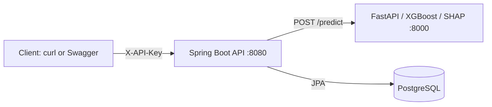

# Architecture

The Java API validates student input, sends it to the internal Python service, receives an illustrative score and SHAP factors, and stores a history row. Health checks also query the Python service.

**Security boundary:** PostgreSQL and model endpoints are internal Docker Compose services. API key is required for prediction endpoints; Swagger UI and health are public. This is a demo, not production authorization or student-data privacy architecture.
